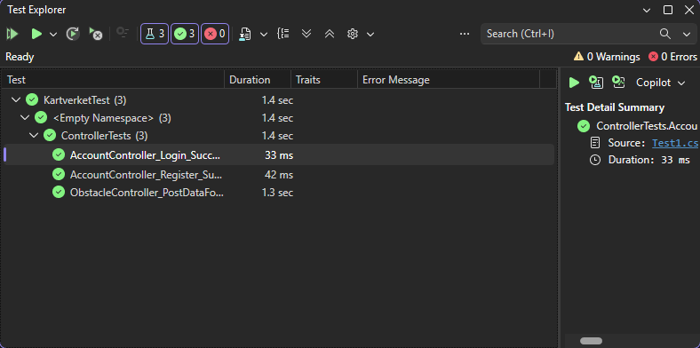
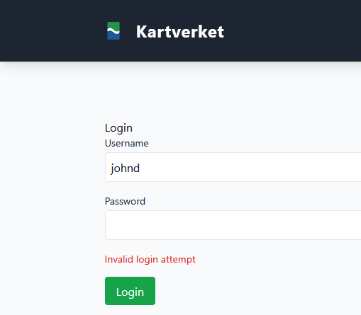

# Kartverket Project

Register and view obstacles on the map, even without an internet connection.

## Table of Contents

### Setup
1. [Getting Started](#getting-started)
2. [Offline Map](#offline-map)
3. [Test Users](#test-users)

### Errors
4. [Resetting Migrations](#resetting-migrations)
5. [An error occurred using the connection to the database](#an-error-occurred-using-the-connection-to-the-database)

### Architecture
6. [Model View Controller](#model-view-controller)
7. [Docker](#docker)
8. [Frontend](#frontend)
9. [Backend](#backend)
10. [System Context Diagram](#system-context-diagram)
11. [Mermaid Diagram](#mermaid-diagram)

### Testing
12. [Unit Testing](#unit-testing)
13. [System Testing](#system-testing)
14. [Security Testing](#security-testing)
15. [User Testing](#user-testing)

### Future Improvements
16. [Fat Controller](#fat-controller)

### Contributors
17. [Contributors](#contributors-1)

## Getting Started

Requirements:

1. Docker Desktop
2. Visual Studio
3. The offline map, otherwise you cannot place a marker or submit a report. See [Offline Map](#offline-map).

1. Open cmd and clone the project

2. Open the solution file in Visual Studio

3. Right click docker-compose, hover over Add, and click New Item.

4. Name the file .env

5. In .env, write DBPASSWORD= followed by a password of your choice. Make sure appsettings.json also contains the password in Pwd=, otherwise it will not work.

6. In Visual Studio:

Tools -> NuGet Package Manager -> Package Manager Console

7. Run the following command (you need Docker Desktop)

docker compose up --build

8. Go to http://localhost:8082 and log in with the test users.

9. To view the map, download the offline map from the Releases page or via the link below.

## Offline Map

To be able to view the map, download the 1.17 GB ZIP file below.

http://github.com/dovidee/KartverketProject/releases/latest/download/norway.zip

Extract the folder and place the norway.mbtiles file in KartverketProject/KartverketProject/wwwroot/

## Test Users

username:password

1. johnd:admin (NLA, admin)
  
2. janed:admin (NLA, reviewer)
   
3. bobs:admin (NLA, user)

4. janiced:admin (Luftsforsvaret, reviewer)

## Resetting Migrations

1. Delete the migrations folder

2. Switch to KartverketProject 

3. In Visual Studio:

Tools -> NuGet Package Manager -> Package Manager Console

4. Run the following commands

Add-Migration NewMigration

Update-Database

## An error occurred using the connection to the database 

1. Open cmd, list the volumes with "docker volume ls" and then run "docker volume rm {VOLUMENAME HERE}". If it says the volume is in use, go to Docker Desktop and delete the container.

2. Run the project as docker-compose to set the volume up again.

## System Architecture

### Model View Controller

MVC makes it easier to code, debug and test something that has only one responsibility.

The model represents the business logic or the operations. This can take the form of error messages or storage of data transfer objects.

The view is responsible for presenting content through the user interface. This covers layout and pages.

The controller handles user interaction and governs how the application responds to a given request.

The user wants to register an account. The POST request hits the controller, which then receives the model. If model validation fails, the model state stores the error. The controller then checks whether the model state is valid and returns the view.

### Docker

Docker is a platform that packages the application and its dependencies into a container.

The Dockerfile contains the instructions for building a Docker image.

The image is then used to build the application.

docker-compose.yml is a configuration file that sets up the containers, where it pulls the password from the .env file.

The application then mounts the volumes from the host into the container.

### Frontend

Static files are served from wwwroot to the user's browser.

https://github.com/dovidee/KartverketProject/blob/c7bc85a6db046f4227ac6778df9241b47b521a0c/KartverketProject/Program.cs#L102

CSS is used to style the website. The project uses Tailwind CSS to simplify this.

JS is used to make the page interactive. The project uses Leaflet to create the map.

### Backend

ApplicationDbContext uses dependency injection to resolve services such as ASP.NET Core Identity for logging in and registering users.

The roles admin, reviewer and user are created. The user is created with a hashed password, since storing passwords in plaintext is a security risk.

IdentityUser is customized from the User model with additional attributes such as Department and Active, as the stakeholders required.

Once the models are defined, the tables are created by migrating and updating the database through object relational mapping.

The project uses Entity Framework, which supports LINQ queries that perform Create, Read, Update and Delete operations on the database.

The controller is then responsible for returning views, model binding, model validation and model errors.

### Mermaid Diagram

Made with https://mermaid.live

### System Context Diagram

Based on the C4 model: https://c4model.com/diagrams/system-context

## Unit Testing

### Obstacle submission
Checks whether the obstacle is saved
https://github.com/dovidee/KartverketProject/blob/b81e030862e7a890a0c09e3c74813510f822684f/KartverketTest/Test1.cs#L17-L59

### Redirect on login
Checks whether the user is redirected once they are logged in
https://github.com/dovidee/KartverketProject/blob/b81e030862e7a890a0c09e3c74813510f822684f/KartverketTest/Test1.cs#L62-L100

### Redirect on register
Checks whether the user is redirected once they have registered
https://github.com/dovidee/KartverketProject/blob/b81e030862e7a890a0c09e3c74813510f822684f/KartverketTest/Test1.cs#L103-L145

### Results
 

## System Testing

### Value range

During system testing, editing the report height with a large value led to this problem:

"Value was either too large or too small for an Int32."

The range was corrected from [Range(0, 200)] to [Range(0.0, 200.0)]

### Empty form

The user submits empty data in the form.

The draft can now be edited with the empty data.

### Offline map

The map renders online (without throttling) with a green HTTP status (200)

The map renders offline with no HTTP status.

## Security Testing

### ZAP

ZAP flagged Content Security Policy as a high risk.
The use of the Tailwind CDN, HTTP and an unspecified Content-Type is a security risk.
In production, the data would have been stored locally instead.
In addition, HTTP would have been migrated to HTTPS to avoid plaintext passwords being visible over the network.

[View the ZAP report](security/zapscan.html)

Download the ZAP report above to see the security issues.

### The CIA Triad

#### Confidentiality

Reviewers are restricted based on these criteria:

1. Whether they own the report
2. Whether the report has been shared with them
3. Whether they belong to the same department

https://github.com/dovidee/KartverketProject/blob/9073420b0a123a217a8d737adba32ce542875756/KartverketProject/Controllers/AccountController.cs#L398-L401

If a report has been shared with them, they cannot share it onward.

https://github.com/dovidee/KartverketProject/blob/9073420b0a123a217a8d737adba32ce542875756/KartverketProject/Controllers/AccountController.cs#L470-L472

This preserves confidentiality, since reviewers cannot pass the report on to standard users.
In addition, the need-to-know principle requires that only users who need the information should have access to it.

#### Integrity

Root users have full access to the file system.

https://github.com/dovidee/KartverketProject/blob/4dfe9b01d0d3ad47ad11f4ed9ea5672a0cce5419/docker-compose.yml#L19-L24

user: "999:999" runs the MariaDB container as a non-root user instead of root.
The application connects to the database as appuser instead of the root database account.
In addition, the principle of least privilege requires that users have the minimum access needed to perform a task.

#### Availability

If the database crashes, the application can no longer save or show reports.

https://github.com/dovidee/KartverketProject/blob/4dfe9b01d0d3ad47ad11f4ed9ea5672a0cce5419/docker-compose.yml#L18-L35

restart: always restarts the mariadb container if it stops.
The health check pings the database every 10 seconds and marks the container as unhealthy after 5 failed pings in a row.

### OWASP: Security Misconfiguration

#### Stack Trace

A stack trace can reveal errors that can be used for error based SQL injection or XSS.

https://github.com/dovidee/KartverketProject/blob/b81e030862e7a890a0c09e3c74813510f822684f/KartverketProject/Program.cs#L84-L88

Outside the Development environment, an exception handler shows an error page instead of the stack trace.
During development, developers need the stack trace to find problems, so it is still shown there.
docker-compose.yml and docker-compose.override.yml set ASPNETCORE_ENVIRONMENT=Production, so the stack trace is hidden. Set it to Development to see it while debugging.

### OWASP: Identification and Authentication Failures 

#### Brute Force

On insecure websites, attackers can uncover valid usernames because the error messages distinguish between them:

1. "Username/email already taken" confirms that the username already exists.
2. "Incorrect password" confirms that the username is correct, but that the password is wrong.

This application instead shows a generic message, "Invalid login attempt", no matter what is wrong, including when the account is locked.
After 5 failed attempts, the account is locked for 15 minutes.

Registration shows the same message whether the username is taken or the password is too weak.
This only partly helps: with a strong password, a failed registration still means the username is taken.
OWASP recommends emailing an activation link instead, which this application does not have.

### OWASP: Injection

#### XSS

XSS can inject JavaScript into other users' pages.
Let us say the attacker uses {}; alert(0); // in BurpSuite.
The payload is then URL encoded for subsequent requests:

They can then display the alert on the page.

It is safe to fetch the model and parse the HTML as textContent, as long as it is not inserted into innerHTML.

https://github.com/dovidee/KartverketProject/blob/433e47255b20bc2ca6cc992841a94e9dc0285d14/KartverketProject/wwwroot/js/mapoverview.js#L14-L20

The object is then parsed to create a GeoJSON object that displays the marker on the map.

### OWASP: Broken Access Control

#### IDOR

Authenticated users can view their own reports.
But users could potentially change the ID in the URL, such as /EditReport/3, to modify other users' reports.
The code below checks that the report belongs to the logged in user before showing it.

https://github.com/dovidee/KartverketProject/blob/b81e030862e7a890a0c09e3c74813510f822684f/KartverketProject/Controllers/AccountController.cs#L235-L245

If the report belongs to someone else, Forbid() redirects them to "Access Denied".
If the ID does not exist, they get the error page instead.

This way, users cannot manipulate the URL to modify other people's reports.

Hidden form fields can also be changed by the user, so when a report is saved, the obstacle is taken from the checked report instead of the ObstacleId sent in the form.

#### CSRF

CSRF tricks an authenticated user into performing an unintended action.
The attacker crafts a URL with the form that the user clicks.
This can be devastating if the user is an admin.

https://github.com/dovidee/KartverketProject/blob/fb0fb4271ddc0f080dec6b35b7023c38041efda0/KartverketProject/Views/Obstacle/DataForm.cshtml#L57-L58

The anti forgery token is embedded in the form

https://github.com/dovidee/KartverketProject/blob/fb0fb4271ddc0f080dec6b35b7023c38041efda0/KartverketProject/Controllers/ObstacleController.cs#L34-L35

[ValidateAntiForgeryToken] makes the controller reject the request if the token is missing or wrong.
Every POST action in the project has it.

The malicious site will not have a matching CSRF token, which stops the attacker.

### Content Security Policy

https://github.com/dovidee/KartverketProject/blob/b81e030862e7a890a0c09e3c74813510f822684f/KartverketProject/Program.cs#L96-L112

Content-Security-Policy controls which sources the page may load scripts, styles, images and fonts from.
default-src 'self' is the fallback, frame-ancestors 'none' blocks other pages from framing it, and form-action 'self' only lets forms submit to this site.

X-Frame-Options is set to DENY, so the page cannot be shown in an <iframe> at all, not even on the same origin.

X-Content-Type-Options prevents attackers from running malicious code such as XSS if the browser guesses the wrong Content-Type.

Referrer-Policy is set to strict-origin-when-cross-origin, so other origins only see the origin, not the path or query string, and HTTPS pages send no referrer to HTTP pages.

Strict-Transport-Security tells the browser to only use HTTPS for this site for one year (max-age=31536000).

## User Testing

The usability of the application was tested on a close family member.

https://youtu.be/Tqa0U8SsCfY

The video above shows that the user is unsure how to:

1. Interact with the map.
2. Draw a marker.
3. See the form.

The form was placed on the right, as well as on the overview page.
In addition, a drawing mode was added to toggle drawing on and off.

## Future Improvements

### Fat Controller

AccountController has grown to over 600 lines and 19 actions.
It handles login and registration, but also editing, deleting, reviewing and sharing reports, and it queries the database directly about 30 times.

Future improvements:

1. Keep AccountController for account actions only: register, login, logout and profile.
2. Move the report actions into a ReportController, and reviewing and sharing into a ReviewController.
3. Move the database queries and the permission check into a service, such as ReportService, so the controllers only handle requests and return views.

This makes it hard to test, since every test has to set up the whole controller with UserManager, SignInManager and the database.

The same permission check (owner, shared with, or same department) is also copied into several actions.

## Contributors

Special thanks to DAkintola94 for the help, and for letting us reuse his Core Identity code.

You can find his project here:

https://github.com/DAkintola94/MatFrem/tree/main

Generative AI was used to generate Tailwind CSS pages and to improve existing code.
